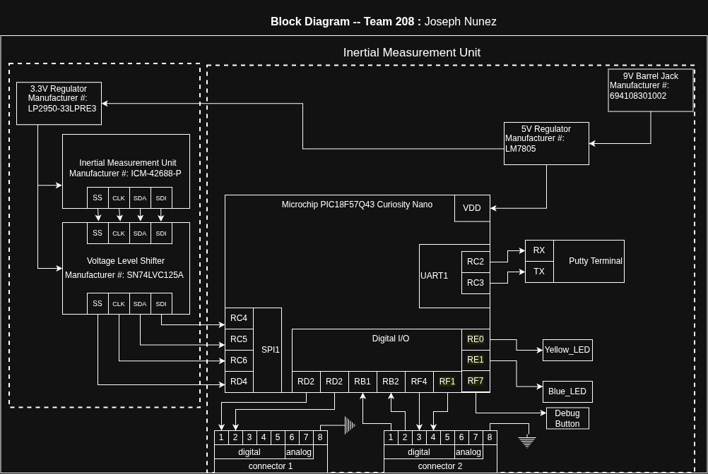

## Overview

The block diagram organizes the electrical components into corresponding sections, allowing for a smoother planning process. We will have two Voltage Regulators: a 5V regulator for the PIC18 and a 3.3V regulator for the Voltage Level Shifter and Inertial Measurement Unit. The 5V regulator will be connected to an external 9V source through a Barrel Jack, and it will supply the 3.3V Linear Regulator. My board requires 6 external connections with my team in order to achieve bidirectional communication (4 wires) with the Distance Sensor Board and Unidirectional communication with the Motor Driving Board (2 wires). Communication between boards will be done using Binary states representing the rotation direction of the motor: Clockwise, Counter-Clockwise, Stopped.

## Block Diagram 

