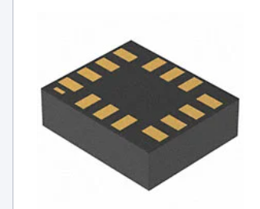
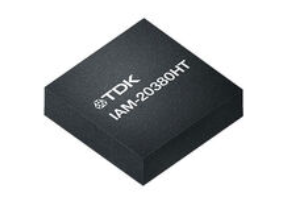
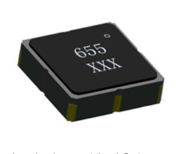
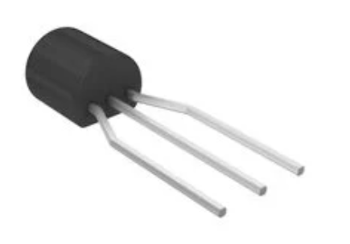
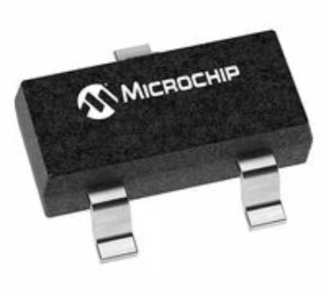
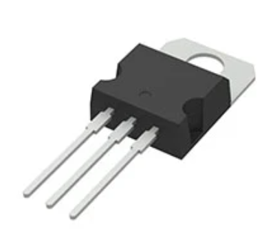
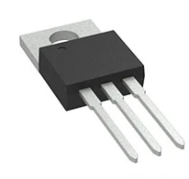
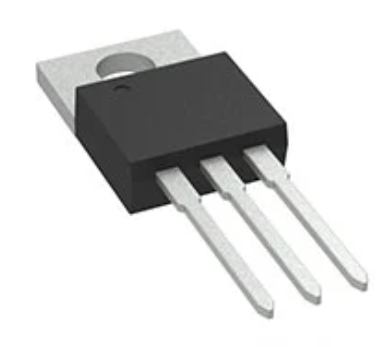
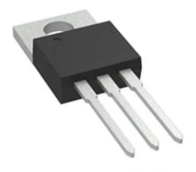

1. ICM-42688-P IMU

    

    * $4.86/each
    * [link to product](https://www.digikey.com/en/products/detail/tdk-invensense/ICM-42688-P/10824934?s=N4IgTCBcDaIJIGECyBaALGAbADmygCiALoC%2BQA)

    | Pros                                           | Cons                                                                  |
    | -----------------------------------------      | ----------------------------------------------------------------      |
    | Measures both acceleration and angular velocity| More complex firmware requirements                                    |
    | Accelerometer Provides absolute reference to gravity | 14-Pin LGA Package                                       |
    | Direct SPI communication       |  Sensor Fusion may be required

1. IAM-20380HT Gyroscope

    

    * $11.35/each
    * [Link to product](https://www.digikey.com/en/products/detail/tdk-invensense/IAM-20380HT/16891558)

    | Pros                                                              | Cons                |
    | ----------------------------------------------------------------- | ------------------- |
    | Directly measures angular velocity for simple integration         | Accumulates drift over time, skewing values  |
    | Can operate at higher frequencies for better accuracy             | Requires additional sensor for reliability   |
    | Simpler data interpretation than IMU                              | More expensive & 16-pin LGA                  |

1. MXC6255XUADXL345BCCZ-RL7 Accelerometer

    

    * $7.56/each
    * [Link to product](https://www.digikey.com/en/products/detail/memsic-inc/MXC6255XU/5658594)

    | Pros                                                              | Cons                |
    | ----------------------------------------------------------------- | ------------------- |
    | Gives absolute tilt reference based off gravity's direction      | Will also include translational acceleration |
    | Drift does not accumulate over time                               | Limited to 10Hz bandwidth |
    | Simpler angle estimation than both IMU and Gyroscope | LCC6 Package is also difficult to work with|

**Choice:** Option 1: ICM-42688-P

**Rationale:** The ICM-42688-P will provide both accelerometer and gyroscope measurement that can be used to determine the angle of the table. Since the accelerometer can
not distinguish translation movement from rotational movement, angle measurements will not be accurate if a linear movement of the table is achieved, so it does not seem
fitting for the application. The gyroscope would have internal drift error that would need to be supported by another sensor, so the IMU's combination of a gyroscope
and accelerometer will fit for the application. All components have similar packages, so the difficulty when working with the PCB seems unavoidable.

1. LP2950-33LPRE3 3.3V LDO

   

   * $0.69/each
   * [Link to product](https://www.digikey.com/en/products/detail/texas-instruments/LP2950-33LPRE3/3505910)

   | Pros                                                              | Cons                                                  |
   | ----------------------------------------------------------------- | ----------------------------------------------------- |
   | Low quiescent current reduces power consumed by regulator         | Limited to 100mA maximum output current               |
   | Wide input voltage range provides flexibility for power source    | Lower current capability limits future expansion      |
   | Through Hole makes easier PCB assembly                            | TO-92 through-hole package takes more PCB area        |

1. MCP1703AT-3302E/CB 3.3V LDO

   

   * $0.75/each
   * [Link to product](https://www.digikey.com/en/products/detail/microchip-technology/MCP1703AT-3302E-CB/3131472)

   | Pros                                                              | Cons                                                  |
   | ----------------------------------------------------------------- | ----------------------------------------------------- |
   | 250mA output provides more current headroom than LP2950           | Lower maximum input voltage than LP2950               |
   | Very low quiescent current reduces power consumption              | SOT-23 package is more difficult to manually solder   |
   | Fixed 3.3V output simplifies implementation                       | Additional current capability may not be necessary    |

1. LD1117V33 3.3V LDO

   

   * $1.27/each
   * [Link to product](https://www.digikey.com/en/products/detail/stmicroelectronics/LD1117V33/586012)

   | Pros                                                              | Cons                                                  |
   | ----------------------------------------------------------------- | ----------------------------------------------------- |
   | 800mA output provides significantly more current capability       | Higher quiescent current increases power consumption  |
   | Large current capacity allows additional components on 3.3V rail | Higher dropout voltage than other regulator options   |
   | TO-220 package is easier to manually solder and work with         | Large package takes significantly more PCB area       |

**Choice:** Option 1: LP2950-33LPRE3

**Rationale:** The LP2950-33LPRE3 was selected because its 100mA output current will provide sufficient power for the components operating on the 3.3V rail while maintaining low quiescent current. The MCP1703 provides additional output current and lower quiescent current, but the additional current capability is not necessary if the total 3.3V load remains below 100mA. The LD1117V33 provides significantly more output current than required for the application while also consuming more current and requiring more PCB area. The LP2950-33LPRE3 therefore provides sufficient current capability for the application without adding unnecessary power or size.

 1. LM7805CT/NOPB 5V Linear Regulator

   

   * $1.86/each
   * [Link to product](https://www.digikey.com/en/products/detail/texas-instruments/LM7805CT-NOPB/3901929)

   | Pros                                                              | Cons                                                        |
   | ----------------------------------------------------------------- | ----------------------------------------------------------- |
   | 1A output current provides sufficient current for 5V components   | 2V maximum dropout requires input voltage sufficiently above 5V |
   | Includes overcurrent, overtemperature, and short-circuit protection | Linear regulation dissipates excess input voltage as heat |
   | Fixed 5V output simplifies implementation                         | TO-220 package requires more PCB area than SMD alternatives |

1. LM2940CT-5.0/NOPB 5V LDO

   

   * $2.00/each
   * [Link to product](https://www.digikey.com/en/products/detail/texas-instruments/LM2940CT-5-0-NOPB/32575)

   | Pros                                                              | Cons                                                        |
   | ----------------------------------------------------------------- | ----------------------------------------------------------- |
   | Lower dropout voltage allows operation with input closer to 5V    | Higher quiescent current than LM7805                        |
   | 1A output current provides sufficient current for 5V components   | More expensive than LM7805                                  |
   | Reverse polarity, short-circuit, and overtemperature protection   | Linear regulation still dissipates excess voltage as heat   |

1. LM340T-5.0/NOPB 5V Linear Regulator

   

   * $2.02/each
   * [Link to product](https://www.digikey.com/en/products/detail/texas-instruments/LM340T-5-0-NOPB/6237)

   | Pros                                                              | Cons                                                        |
   | ----------------------------------------------------------------- | ----------------------------------------------------------- |
   | 1.5A output provides more current capability than other options   | Additional current capability may not be necessary          |
   | Fixed 5V output simplifies implementation                         | 2V maximum dropout requires input voltage sufficiently above 5V |
   | Includes overtemperature and short-circuit protection             | Linear regulation dissipates excess input voltage as heat   |

**Choice:** Option 1: LM7805CT/NOPB

**Rationale:** The LM7805CT/NOPB was selected because its 1A output is sufficient current for the components operating on the 5V rail while maintaining a simple fixed 5V output. The LM2940 has a lower dropout voltage, which is beneficial if the input voltage were close to 5V, but this advantage is not necessary since it will be supplied by a 9V power supply. The LM340 provides a higher 1.5A output current, but the additional current capability is unnecessary if the total 5V load remains below the LM7805's 1A rating. The LM7805 therefore provides sufficient current capability for the application without requiring the additional cost or capabilities of the other regulators.
