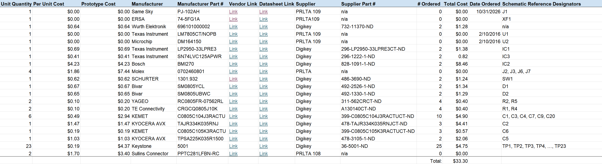

## Overview
This page contains the Current Bill of Materials (BOM) for the Inertial Measurement Board, displaying all the necessary IC's, Passive Components, Connectors, and Test Points for the development and debugging of the board.

## Bill of Materials

