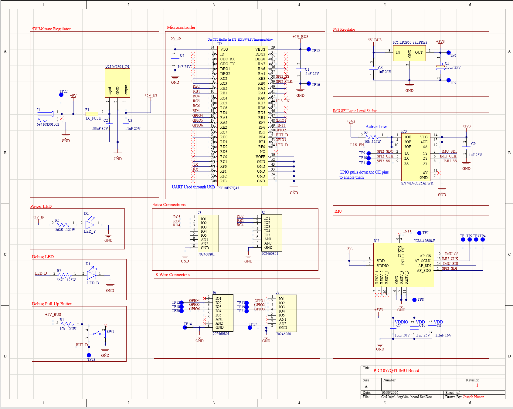

## Overview

This schematic is design to support IMU Sensor data sampling using a PIC1857Q43. It will utilize a 5V linear
regulator for Microcontroller power and a 3.3V Linear regulator for IMU and logic level shifter power. The
logic level shifter allows for communication between the PIC and the IMU though they operate
on different voltage levels. Finally, the IMU's values will be displayed as angular values
on a terminal via UART.

## Resources

The schematic as a PDF download is available [here](schematic.pdf), and the Zip folder of the project [here](egr304_Board_Project.zip).
