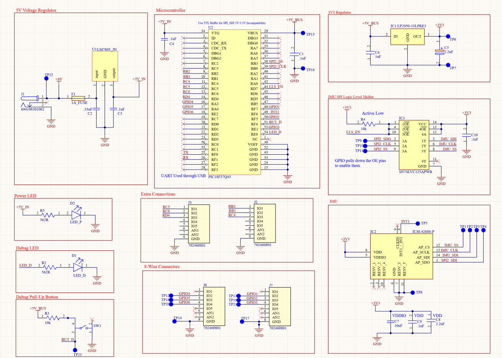

## Overview

This schematic is design to support IMU Sensor data sampling using a PIC57Q43. It will utilize a 5V linear.
regulator for Microcontroller power, a 3.3V Linear regulator for IMU power as well as a logic level shifter
for communication between the PIC and the IMU. Finally, the IMU's values will be displayed as angular values
on a terminal via UART.

**Figure ##:** Showing a example schematic.

## Resouces

The schematic as a PDF download is available [here](schematic.pdf), and the Zip folder of the project [here](egr304_joseph_nunez_schematic.zip).
